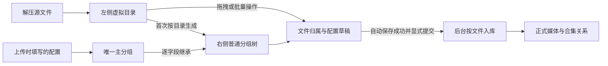

# 压缩包全屏入库工作台需求访谈

日期：2026-10-26。状态：用户已授权实施，管理端与后端实现、自动化验证及独立代码评审已完成，等待用户在实际上传场景验收。本文保留访谈过程，目标行为以已确认决策与下方验收清单为准；验证范围见文末。

## 最终需求概览

上传并解压后进入可刷新恢复的独立全屏工作台。左侧是可右键、多选和拖拽的虚拟文件管理器；右侧是以主分组为根的入库分组树，文件、分组和新建合集的编辑在页面内展开。

主分组承载上传时填写的标题、说明、标签及两类合集。目录生成的分组默认逐字段继承父组，文件显式覆盖优先；显式清空和恢复继承是两种操作。目录树与分组树在初始化后独立维护，不修改源文件的物理名称或位置。

箭头“首次按目录生成”只表示初始化，不代表后续目录和分组持续同步。根目录文件直接归主分组；移出普通组或删组后的成员进入独立“未分组”区，仍继承主分组默认值。

| 对象 | 入库目标与关联 | 默认元数据 |
| --- | --- | --- |
| 视频 | 进入全部选中视频合集，关联全部选中图片合集 | 主分组 → 祖先组 → 当前组 → 文件显式覆盖；标签与视频类型仅作用于视频 |
| 图片 | 进入全部选中图片合集 | 默认使用虚拟文件名标题；说明与图片合集按层级继承，单文件覆盖优先 |
| 库内重复媒体 | 复用既有实体，只追加本次合集及图片合集关系 | 保留原标题、说明、标签；视频类型冲突失败 |

视频和图片合集均允许为空，预览提示后可确认继续。新建合集立即成为正式合集，草稿取消不撤销新建合集。新流程不再自动建立逐张视频图片关系，历史已有关系保留。

拖拽只修改草稿；“入库所选／入库本组／全部入库”固定成员及有效配置后交给后台处理。离开页面不取消，返回恢复进度；处理中成员锁定，其他未提交成员仍可整理。成功文件禁止换组、排除和修改入库配置；其所在分组及祖先禁止删除，默认值变化只影响未入库成员。

## 交付范围

- 修改管理端和 Go 后端，包含可回滚的必要数据迁移、后台入库任务、关系追加与保护校验。
- 手机与 TV 多图片合集入口另行交付；本次保存完整多选关系，保留现有单个兼容入口，新视频使用首个选中图片合集。
- 左侧支持新建目录、改名、移动、排除和恢复，不提供复制；不操作原有物理文件。
- 旧批次保留原配置、归属及分组，不因打开新工作台重建；只允许尚无成功文件且无活动入库任务的批次经确认重新解压并重置整理结果。
- 删除、重新解压和提交预览可用简短确认弹窗；文件、分组和合集编辑不使用抽屉或复杂表单弹窗。

## 用户已明确的要求

- 上传压缩包后的操作改为全屏工作区，取代抽屉弹窗。
- 左侧模拟文件管理器，提供右键操作；文件整理只改变模拟关系，不实际改动原有物理文件。
- 右侧为入库分组，允许创建、删除，也能按文件夹默认创建。
- 分组具有默认标题、标签、视频合集和关联图片合集；关联图片合集可多选，视频合集和图片合集均可在操作中创建。
- 分组默认继承父分组；主分组就是上传时填写的内容，其结构与根目录文件归属已在第四轮确认。
- 标题策略能够切换为按文件标题录入。
- 左侧文件可拖入右侧分组；视频进入视频合集，图片进入关联图片合集，支持批量操作。

## 访谈开始时核实的旧实现与冲突

- `internal/models/models.go` 的 `ArchiveImportGroup` 暂无父分组标识；现有分组是平级关系。现有继承是批次默认值、分组默认值、文件字段覆盖，并非分组树继承。
- 文件目前只有一个分组归属。新增多分组引用会改变现有关系，必须明确选择。
- `CONTEXT.md` 的既有词条将视频关联图片图集限制为一个；代码中单文件编辑和入库已存在多选支持，但部分分组和批量路径仍调用单选校验。本次需明确统一的多选语义与覆盖范围。
- 既有词条记载文件初始未分组、分组单媒体类型；当前解压代码已按直接目录生成分组并支持混合媒体，文档与代码存在差异，不把历史词条直接当作本次需求。
- 现有文件名派生标题、原标题转存描述、已入库文件冻结等规则均需在后续访谈确认保留范围。
- 第二轮核实：手机与 TV 的视频详情仍读取单个图片合集；多图片合集关系表与直接视频图片关系已有写入，但未接入这两端的详情展示。工作台多选与 App 多入口展示是不同的交付范围。
- 普通 hash 命中会复用已有媒体并追加所属合集，保留原标题、说明和标签；但视频关联图片合集目前会经过全量替换，存在清除旧关联的风险。同批次已成功文件直接跳过，再提交不会应用新配置。
- 图片实体目前没有标签和视频业务类型，分组的这两个字段实际只用于视频；标题、说明和图片合集适用于图片。
- 重新解压前端仅在部分失败类状态开放，后端缺少对齐校验且会清理文件记录与解压目录；已入库媒体不随之回滚。新草稿持久化必须明确重解压时的配置保留边界。

## 首轮已确认决策

用户回复“按推荐”，确认首轮九项建议：

1. 独立全屏页面，收起侧边导航，提供“返回批次列表”，刷新后可恢复当前批次入口。
2. 左侧支持新建文件夹、重命名、移动、排除入库和恢复；首期不支持复制；所有整理不改动原有物理文件。
3. 每个文件最多属于一个入库分组，允许视频和图片混合分组；移到另一组时替换归属。左侧始终保留源文件入口并显示归属。
4. 按文件夹创建分组时保留对应层级，创建后两棵树独立维护，左侧目录调整不自动改右侧分组。
5. 逐字段动态继承父分组；显式覆盖保留，提供“恢复继承”，显式清空与继承不同。
6. 视频合集和图片合集均可多选；组内每个视频进入全部选中视频合集，并关联全部选中图片合集；组内每张图片进入全部选中图片合集。
7. 分组提供“统一标题／按文件名”模式，默认影响视频；图片默认使用各自文件名，文件单独标题优先。
8. 拖拽仅整理待入库配置，显式执行“入库所选／入库本组／全部入库”才创建正式媒体。
9. 虚拟目录、分组、归属和配置按批次自动保存，重新进入可恢复并显示保存状态。

以上记录访谈时确认的目标行为；与旧词条相冲突的旧规则不能作为本次实现依据。物理文件、虚拟目录、入库分组和正式媒体的职责边界见 ADR 0032。

## 第二轮已确认决策

用户再次回复“按推荐”，确认 Q10～Q20 的十一项建议：

10. 首次解压完成后自动按目录生成分组，保留有媒体文件的目录及其祖先层级，跳过空目录；文件归直属目录对应分组。再次生成只补缺失项，不覆盖人工归属；根目录文件归属等待主分组规则。
11. 拖动文件夹递归处理全部可入库文件，统一移入目标组，不隐式创建子组。排除及恢复递归操作，保留原归属与配置。
12. 允许空组，同级不重名，不同父组下可同名。删除待入库父分组时，经确认连同子组删除，成员回未分组并保留单文件覆盖，不删除源文件。
13. 标签和合集的显式覆盖整项替换父值，恢复继承才跟随父组。保留说明与视频类型配置；标签和视频类型仅作用于视频，不给图片扩展标签功能。
14. 分组显示名与入库标题独立。按文件名模式使用当前虚拟名称，去扩展名并沿用既有广告文本清理；继承重算不自动转存旧标题到说明，保留显式转存操作。
15. 工作台新建合集立即创建正式合集并选中；取消本次入库后仍保留，提示“合集已创建”，可在合集管理中删除空合集。
16. “入库本组”包含子组，提交前展示数量；逐文件执行并展示结果，仅重试失败项。成功文件的入库配置冻结，分组后续修改只影响未入库文件。
17. hash 命中已有媒体时复用实体，保留标题、说明和标签，只追加本次所属合集及图片合集关联，不删除已有关系；视频类型冲突时报错。
18. 保存成功后才能入库；保存失败保留当前编辑并提供重试。多窗口修改同批次时提示冲突，不静默覆盖。
19. 旧批次保留原分组、归属和配置，首次进入不重建；重新解压仅对尚无成功入库文件的批次开放，明确确认重置整理结果。
20. 本次交付范围为管理端与后端完整多选关系；手机、TV 的多入口展示另做任务，本次保留单个兼容入口与完整关联数据。

## 第三轮已确认决策

用户回复“Q21: 主分组，就是上传是填写的内容；其他按推荐”：

21. 主分组代表上传时填写的内容，不引入另一套独立业务默认配置。唯一根节点、是否允许删除及根目录成员归属在第四轮明确，不能将本次术语解释扩大为所有结构建议均已接受。
22. 成功文件禁止换组和排除；包含成功文件的分组及其祖先禁止删除。分组默认值仍可修改，但只作用于尚未入库成员。
23. 新流程统一通过图片合集关联，不再自动生成同目录视频到单张图片的直接关系；历史已有直接关联保留。

## 第四轮已确认决策

用户回复“按推荐来”，确认 Q24～Q28：

24. 主分组呈现为当前批次唯一、不可删除、可编辑的根节点，所有普通组均位于其后代；根目录文件直接归主分组。保留不可删除的“未分组”虚拟区承接移出组或删组的成员，未分组文件采用主分组默认配置。删除普通分组沿用 Q12，不改为自动加入主分组。
25. 上传时的标题、说明、标签与两类合集成为主分组初值；标题留空沿用压缩包去扩展名的名称，视频类型默认短视频。新建或按目录生成的普通组只设置显示名，其余字段全部继承，不自动把目录名覆盖成视频标题。用户显式切换到空白统一标题时，阻止受影响文件入库并指出问题。
26. 视频合集与图片合集均可为空，不自动创建合集；提交预览提示无视频合集的视频、无所属图片合集的图片及无图片合集关联的视频，允许明确继续，文件进入对应媒体库。已入库媒体的单个 App 兼容入口保留，新增视频优先使用本次首个选中图片合集，完整多选关系仍保存。
27. 入库任务由后台持续处理，离开或刷新工作台不取消；提交时固定本次成员及有效配置，处理中成员禁止改名、换组、排除及修改入库配置，其余未提交文件仍可整理。返回后恢复逐文件进度，失败项可调整后重试。
28. 全屏约束针对整个入库工作台，文件编辑、分组编辑和新建合集在当前页面展开，不叠加抽屉或复杂表单弹窗；删除、重解压及提交预览允许简短确认弹窗。

## 验收清单

以下均为待实现后的验收标准，本轮没有运行功能验收。

| 编号 | 场景 | 预期结果 |
| --- | --- | --- |
| A01 | 上传后打开工作台，刷新及返回 | 独立全屏、侧栏收起，批次可定位恢复，返回列表正常 |
| A02 | 对虚拟目录新建、改名、移动 | 虚拟展示与关系更新，源文件物理路径、名称和内容不变 |
| A03 | 首次解压根目录、嵌套目录和空目录 | 根目录文件归主分组；生成媒体目录及祖先组；空目录无多余组 |
| A04 | 改目录后再次按目录建组 | 两侧不持续联动；只补缺失项，不覆盖人工归属 |
| A05 | 修改父组字段、子组覆盖、显式清空、恢复继承 | 逐字段计算，集合覆盖整项替换；单文件覆盖保留 |
| A06 | 多选视频和图片、拖入组、拖动整文件夹 | 递归收集可操作成员，全部单组归属；不复制媒体或自动新建子组 |
| A07 | 排除和恢复文件夹 | 递归改变入库资格，恢复保留归属与配置，成功文件不可排除 |
| A08 | 创建空组、同级重名、跨父组同名 | 空组可保留；同级重名失败，跨父组同名允许 |
| A09 | 删除待入库分组树或移出分组 | 普通组确认后删除；文件回未分组、保留覆盖并继承主组，不删除源文件 |
| A10 | 删除主组或包含成功文件的分组及祖先 | 前后端均拒绝，已有归属与媒体不受影响 |
| A11 | 统一标题、文件名模式、虚拟改名、空标题 | 统一模式继承上传标题；文件名模式去扩展名及指定广告文本；显式空白统一标题阻断受影响文件 |
| A12 | 继承更新与显式原标题转存 | 自动重算不积累说明；显式转存动作沿用既有标题转存规则 |
| A13 | 视频选多视频合集、多图片合集，图片选多图片合集 | 视频进入全部选中视频合集并关联全部图片合集；图片进入全部选中图片合集 |
| A14 | 新建两类合集后取消入库 | 合集立即可选且正式存在，取消不删除；空合集可在合集管理删除 |
| A15 | 未选两类合集并提交 | 预览逐类提示，可确认继续；不自动建合集、不遗漏媒体入库 |
| A16 | 库内已有同内容文件再次入库 | 复用实体，追加关系且不删历史关系，不覆盖原标题、说明、标签；视频类型冲突失败 |
| A17 | 新入库同目录视频图片与历史直接关联 | 新流程只建图片合集关系；历史逐图片关系保留 |
| A18 | 修改草稿、保存失败、多窗口冲突后入库 | 只允许已成功保存且版本一致的草稿提交；失败保留本地编辑，冲突不静默覆盖 |
| A19 | 入库所选、本组及全部入库 | 成员去重；本组包含后代；跳过排除、成功与已活动成员；提交固定成员和配置 |
| A20 | 入库中刷新、离开，修改祖先默认值 | 后台继续，返回恢复状态；本次配置快照不变，其余未提交成员仍可整理 |
| A21 | 部分失败，修改失败项后重试及重复点击提交 | 显示逐文件结果；仅处理可重试失败项，不重复创建成功媒体或并发处理相同成员 |
| A22 | 成功后改变组默认值或尝试换组 | 成功文件配置及归属不变；尚未入库文件按继承规则更新 |
| A23 | 旧批次打开及尝试重新解压 | 保留旧整理；有成功文件或活动入库任务时不允许重解压，其余经确认重置 |
| A24 | 手机和 TV 请求已入库视频 | 现有单图片合集入口仍可用，完整多关联保存在后端，本次不改 App 界面 |
| A25 | 编辑文件、分组及创建合集 | 表单在页面内展开，仅危险操作和提交预览出现简短确认弹窗 |

## 实施分解与验证要求

以下是依据已确认需求形成的工作包，不代表具体数据库/API 设计已经确认或代码已实现。

1. 梳理领域状态、数据模型、向前兼容迁移与旧批次适配：区分物理位置、虚拟目录、分组树、覆盖状态和入库快照；保留现有实体与关联，禁止通过直接改物理目录实现虚拟移动。
2. 实现后端草稿保存与冲突控制、主分组及目录建组、继承重算、批量操作和成功成员保护。关键规则必须由服务端校验，不能只靠按钮禁用。
3. 实现可恢复后台入库、固定提交快照、逐文件状态和幂等恢复；去重追加关系，不清除旧关系，不再自动生成直接逐图片关联。
4. 实现独立路由全屏工作台、两侧树与文件列表、多选右键及拖拽、页面内属性编辑、自动保存提示、提交预览和进度恢复。
5. 定向验证领域规则、数据兼容、关系追加、重复提交和后台恢复，运行管理端现有 Vitest 测试及 `npm run build`，按影响范围运行 Go 测试、`go vet`、`go build`；安排独立评审并复验阻塞问题。只有实际执行后的结果才能记为通过。

处理中记录不能被删组、批次删除、重解压等动作移除，否则将无法满足已确认的后台快照与进度恢复语义；具体事务、任务投递和恢复机制在技术设计中确定。迁移需允许上一版本二进制继续运行于新 schema，必要时将行为回滚与数据保留分别说明。

## 后续收口

本次访谈已逐项确认全部二十八项产品决策，用户随后明确授权进入实现。上述工作包已落地；验收清单继续作为实际使用验收依据，不能把自动化及模拟浏览器验证等同于用户在部署环境的完整验收。

## 实施与验证记录（2026-10-26）

工作台路由为 `/toolbox/archive-import/:id`，上传完成、批次列表和恢复入口均进入独立页面。新增 `0047` 为兼容性加表/加列迁移；旧批次首次打开才生成草稿，源记录及物理路径不变。提交固定已保存版本和逐文件快照，持久作业由 archive 队列唤醒，worker 启动和每分钟扫描恢复待处理作业。

| 验证方式 | 实际覆盖 | 边界 |
| --- | --- | --- |
| Go 规则与 handler 单测及定向 race | 继承/清空/标题优先级、树循环、主组/成功/活动保护、新旧初始化、版本冲突响应、旧接口保护 | 纯规则与接口测试不替代真实上传 |
| 本机 PostgreSQL 18.4 隔离库集成及 race | 全量迁移与 0047 重复执行/撤销/重放；真实 service/repository 的草稿版本、任务快照、失败重试、丢唤醒恢复、成功后作业恢复与统计刷新、视频/图片去重、多合集追加、批次删除保留媒体、旧图片标题和路径式组名、重解压清理失败恢复 | 队列使用故障注入替身；未连接部署数据库，未运行真实 Redis/worker 全链路。测试只接受显式本机 `ARCHIVE_WORKSPACE_TEST_DSN`，自行创建并删除独立测试数据库 |
| 管理端 Vitest | 53 个测试文件、792 项通过，包含递归选择/去重、标题/继承、多合集与预览规则 | 未新增测试框架 |
| 管理端浏览器模拟接口 | 全屏显示和自动保存、递归混合拖拽、目录循环拒绝、批量字段、批量新建合集回填、保存冲突与重载失败保留、补建/提交期间禁止编辑及轮询、提交后成员锁定、重解压失败后清理旧草稿并恢复重试；390px 窄屏无横向溢出 | 使用浏览器真实组件与模拟 API，不宣称已执行 A01～A25 全部真实上传验收 |
| 构建与静态检查 | 管理端 build、Go build/vet、Go 全套（排除下述既有夹具问题）、差异与 UTF-8 检查 | 管理端现有大包提示保留；未部署、未改 App |

Go 全套验证排除了既有 `TestParseTVAPKMetadataParsesReleaseAPK`：仓库 APK 与该测试预期版本不一致（144/121），与本次改动无关。定向工作台与真实数据库测试均通过。独立代码评审发现的竞态及恢复问题已修复并复验；实际压缩包、真实 Redis/worker、手机/TV 既有入口仍待部署环境验收，本次不标记用户验收完成。
